# TimeBox Evo for Homey

**The pixel heart of your smart home.**

TimeBox Evo turns your Divoom TimeBox Evo pixel display into the friendly screen of your
[Homey](https://homey.app). Homey talks to it directly over Bluetooth and keeps its clock right. Show the time and the
weather in the morning, let a scrolling note tell you that the washing machine is done or that someone rang the doorbell,
start a pizza countdown in the kitchen, or put a snapshot of your doorbell camera on the 16x16 display.

## What you can do

- Pick a mode on the device tile: clock, lighting or your own custom pages.
- Show the clock in several styles and colours, with optional weather, temperature and calendar pages.
- Switch the display on and off, set its brightness and its colour on the device tile; use it as mood lighting in any colour.
- Show a scrolling text from a Flow (and stop it again).
- Show a temperature and a weather type, set by hand in a Flow or automatically from Open-Meteo.
- Start and stop a countdown, and start a Flow when it ends ("Countdown ended" trigger).
- Show an image from an image tag (for example a camera snapshot) or from a URL, scaled to 16x16.
- React to the display being connected or disconnected (triggers and a condition).
- Automatic time sync with the time of your Homey.

## Requirements

- A Homey Pro with Bluetooth (the app runs locally on the Homey, Homey firmware 12.0.0 or newer).
- A Divoom TimeBox Evo within Bluetooth range of the Homey.
- The Divoom phone app must not be connected to the TimeBox: it accepts only one Bluetooth connection at a time.

TimeBox Evo for Homey is an independent community app and is not affiliated with or endorsed by Divoom.

## Development

A [Homey](https://homey.app) app that integrates the **Divoom TimeBox Evo** pixel display
(Bluetooth) into Homey: clock, lighting, custom pages, scrolling text, weather, countdown and images from the device tile and Flows.

> Status: rebuild in progress (see [`docs/roadmap.md`](docs/roadmap.md)). Milestone 0.2.0 (core) is implemented:
> BLE pairing, a `dim` capability, availability, automatic time sync and the Flow cards "TimeBox is connected",
> "TimeBox connected/disconnected".
> Implemented for 0.5.0 (Images, #31 done; #101 "Countdown ended" Flow trigger done; accepted 2026-10-08): the Flow actions "Show image" (image tag) and "Show image from URL" (PNG, JPEG, GIF scaled to 16x16, optional duration) and the device trigger "Countdown ended".
> Implemented for 0.4.0 (Text, weather & countdown, accepted 2026-10-07): the Flow actions "Show text" / "Stop text" (native scrolling text),
> "Set temperature" and "Set weather" (plus optional automatic weather from Open-Meteo in the device settings) and "Start countdown" / "Stop countdown".
> Implemented for 0.3.0 (Display & modes, accepted 2026-10-07): a mode picker (clock, lighting, custom) with Flow cards, the clock face (style, weather, temperature
> and calendar pages in the device settings, Flow action "Show clock"; the clock colour follows the tile colour picker) and power and mood lighting (on/off on the
> tile, one colour picker for the active mode, Flow action "Set lighting" with a colour), plus the Flow action "Show custom page" (1-3). Cloud, visualizations and the scoreboard are not offered; if the device shows cloud or a visualizer, the mode tile is empty.
>
> **Turn everything off:** the TimeBox has an `onoff` capability, so any Homey action that sets it is expected to turn the
> panel off: the tile, the Flow card "Turn off", and zone-wide or voice actions that address `onoff`. "All lights off" and
> voice commands for lights include it too, because the TimeBox is a light device (it can also be added to moods). Turning it on returns to the last mode
> (clock, lighting or custom). Changing the brightness (`dim`) of a switched-off TimeBox does not
> light the panel: the app holds the value and sends it when the panel is switched on again (#62).
> Current version: 1.1.0 (milestone Bugfix after Release 1.0, accepted 2026-10-18). Changelog: `.homeychangelog.json`.

## How this app is built (agent pipeline)

This app is written by AI agents (Claude Code) that run in GitHub Actions. The owner decides **what** gets built and
**whether** the result is good; the agents do the work in between: plan, code, documentation, review and a test on a
real Homey with a real TimeBox, watched by a webcam. All communication happens here on GitHub, in issues and pull requests.

**In plain words:**

1. **An issue describes a feature or a bug.** Anyone can open one, but agents ignore it until the owner approves it with
   the label `agent:approved`.
2. **Safety check first.** Before any agent with tools reads the issue, a separate check without tools looks for text
   that tries to trick an AI ("prompt injection"): hidden instructions, requests for secrets, links to send data to.
   Anything suspicious stops here until the owner looks at it. Comments by people other than the owner are never shown
   to an agent, and an edit of an approved issue cancels the approval.
3. **Rate, clarify, plan.** A planner agent rates the issue (risk and size), asks the owner about anything the issue
   leaves open instead of guessing, and posts the implementation plan on the issue. Too large an issue gets a proposed
   split; a high-risk or very large plan waits for the owner's `/agent go`.
4. **Build.** A developer agent implements the plan with code and tests, a doc-keeper updates the documentation, and the quality gate
   (lint, build, tests, Homey validation) must pass. These agents cannot write to GitHub at all; a separate, simple
   workflow step publishes their branch and opens a pull request.
5. **Review.** A second, independent agent reviews the change, including signs of manipulation (unrelated code, network
   calls, new dependencies).
6. **Hardware test.** On the owner's Mac (a self-hosted runner next to the Homey) a check confirms Bluetooth, the
   camera, the Homey and the TimeBox; then a tester agent installs the build on the Homey, drives it and judges the
   webcam photos. If the TimeBox has to be paired, the owner gets a comment and the test waits. The Mac only runs jobs
   that the pipeline itself started from `main`.
7. **Merge or fix.** All green → the pull request is merged and the next approved issue starts. Otherwise the findings
   go back to the developer (up to three rounds), then the owner is asked.
8. **Owner acceptance.** When every issue of a milestone is done, the agents write test instructions, pre-test what
   they can, and the owner tests the app by hand. `ACCEPTED` → version bump and tag; `REJECTED` → each failing case
   becomes a bug that goes through the same pipeline. Publishing to the Homey App Store stays with the owner.

```mermaid
flowchart LR
  subgraph OWNER["👤 Owner (GitHub issues and PRs)"]
    direction TB
    O1["Write or confirm an issue"]
    O2["Approve: label agent:approved"]
    O3["Answer a question:<br/>/agent answer …<br/>confirm a risky plan: /agent go"]
    O4["Pair the TimeBox<br/>when asked"]
    O5["Check a protected diff:<br/>/agent approve-diff"]
    O6["Test the milestone by hand<br/>(UAT checklist)"]
    O7{"Verdict"}
    O8["Publish to the App Store"]
  end
  subgraph GUARD["🛡️ Pipeline control (plain scripts, no AI)"]
    direction TB
    G1{"Sent by<br/>the owner?"}
    G2{"Injection screen:<br/>AI without tools<br/>+ pattern check"}
    G3["Record approval<br/>(content fingerprint)"]
    G4["Pick next approved issue<br/>(roadmap order)"]
    G5["Push branch, post plan,<br/>open pull request"]
    G6{"Gate green, review OK,<br/>no protected files?"}
    G7{"Hardware test<br/>passed?"}
    G8["Merge"]
    G9["Open UAT issue,<br/>post checklist"]
    G10["Version bump + tag"]
    G11["File bugs for failed cases"]
  end
  subgraph AGENTS["🤖 Agents on GitHub-hosted runners (read-only)"]
    direction TB
    A1["Planner: rate risk + size,<br/>clarify, plan"]
    A2["Developer: code + tests"]
    A3["Doc-keeper: docs"]
    A4["Quality gate"]
    A5["Independent reviewer"]
    A6["Write UAT instructions"]
  end
  subgraph MAC["🖥️ Owner's Mac: hardware runner"]
    direction TB
    M1["Runner check: Bluetooth,<br/>camera, Homey, TimeBox"]
    M2["Install build on the Homey"]
    M3["Tester: drive the app,<br/>judge webcam photos"]
  end

  O1 --> O2 --> G1
  G1 -- no --> X1(["ignored / approval removed"])
  G1 -- yes --> G2
  G2 -- suspicious --> O2
  G2 -- clean --> G3 --> G4 --> A1
  A1 -- question, split, risky plan --> O3 --> A1
  A1 --> A2 --> A3 --> A4 --> G5
  G5 --> A5 --> G6
  G6 -- protected files --> O5 --> M1
  G6 -- findings --> A2
  G6 -- yes --> M1 --> M2
  M2 -- not paired --> O4 --> M3
  M2 --> M3 --> G7
  G7 -- no --> A2
  G7 -- yes --> G8 --> G4
  G4 -- milestone done --> A6 --> M3
  G8 -. UAT docs merged .-> G9 --> O6 --> O7
  O7 -- ACCEPTED --> G10 --> O8
  O7 -- REJECTED --> G11 --> G4
```

Details, rules and the full security model: [`docs/pipeline.md`](docs/pipeline.md) (decision record:
[ADR 0011](docs/decisions/0011-actions-pipeline-public-repo.md)). The documentation in this repository is the complete
knowledge base; GitHub only manages the work.

- Start here for agents and humans: [`CLAUDE.md`](CLAUDE.md)
- Documentation / knowledge base: [`docs/`](docs/README.md)
- How the agent workflow works: [`docs/pipeline.md`](docs/pipeline.md)
